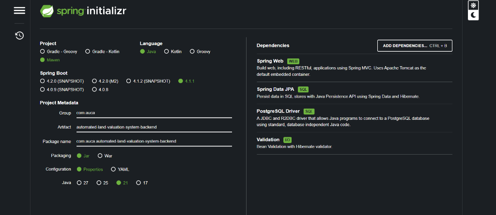

# Automated Land Valuation System Backend

- **Course**: INSY 8322 Web Technology and Internet
- **Student ID**: 27197
- **Student Name**: Niyonshimira Jean Marie

## Project Description

The Automated Land Valuation System is a Spring Boot web service designed to manage land valuation requests, accredited valuers, district offices, landowners, and valuation factors in Rwanda.

## Project Setup

## Technologies Used

- Java 21
- Spring Boot 3
- Spring Data JPA (Hibernate)
- PostgreSQL
- Maven
- Postman

Thank you, this is a project for education purpose.
